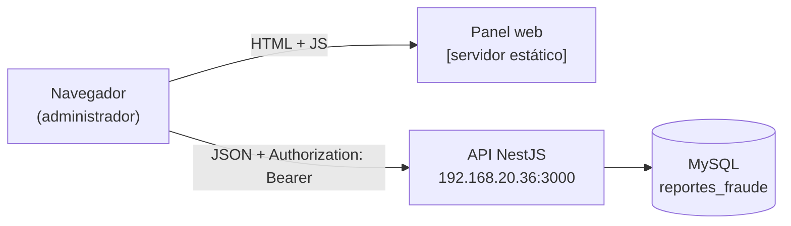
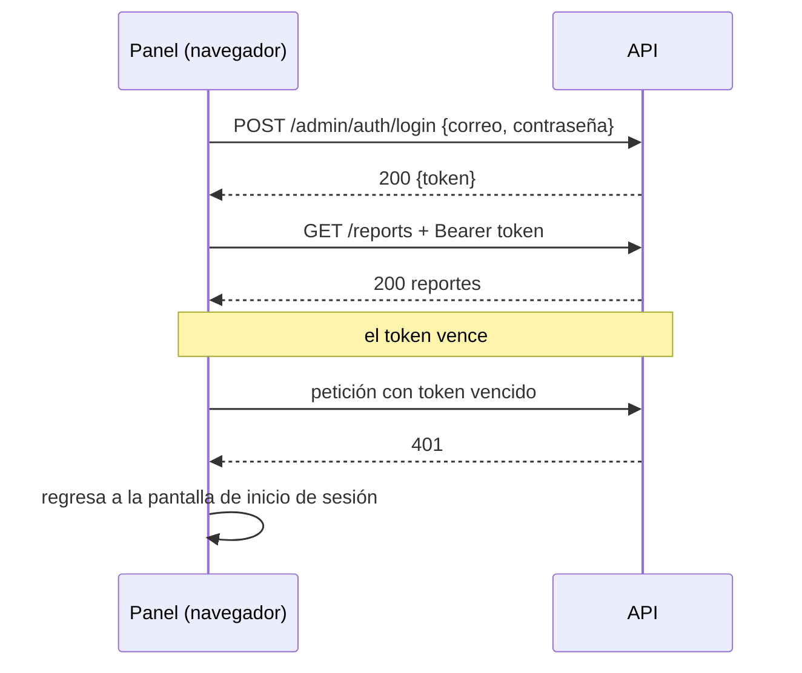

# NetShield — Panel web del administrador

**Versión:** [1.0] · **Fecha:** 2026-10-21 · **Equipo:** Flor Blacina Rodríguez Hernández, Ximena Itzel Camacho Flore, José Leonardo Salinas Ramirez, Randy Angelo Rosas Tolentino


## 1. Resumen

Panel web con el que el administrador de NetShield revisa los reportes de phishing enviados desde la app iOS. Permite iniciar sesión como administrador, ver y revisar reportes, confirmarlos o rechazarlos, consultar usuarios y estadísticas, recibir notificaciones de reportes nuevos, administrar categorías y gestionar invitaciones. Es una aplicación web en HTML, CSS y JavaScript que consume la API REST del backend. Estado: **[funcional con el backend real en la red del proyecto]**.

## 2. Arquitectura



- **Panel** (`[carpeta]`): páginas HTML con JavaScript que llaman a la API con `fetch`.
- **API**: ver el README del backend. El panel no se conecta a la base de datos directamente.
- La URL de la API se define en una sola constante en el JavaScript del panel (**[archivo y nombre de la constante]**).

## 3. Tecnologías

| Capa | Tecnología | Para qué |
|---|---|---|
| Interfaz | HTML5 + CSS3 | estructura y estilos (tema azul marino con acentos amarillo y celeste) |
| Lógica | JavaScript **[vanilla / librería]** | llamadas a la API y manejo de pantallas |
| Gráficas | **[Chart.js u otra]** | estadísticas |
| Iconos / fuentes | **[librería]** | iconografía del menú |
| Servidor estático | **[VS Code Live Server / http-server / nginx]** | servir los archivos |

## 4. Instalación y ejecución

### 4.1 Requisitos
- Navegador actualizado (Chrome, Edge, Firefox o Safari)
- El backend corriendo y alcanzable desde el equipo del administrador
- Estar en la red del proyecto (VLAN de administración)

### 4.2 Configurar la API
Abrir **[archivo JS de configuración]** y poner la dirección real del backend:

```js
const API_URL = 'http://192.168.20.36:3000';   // IP del equipo del backend
```

### 4.3 Servir el panel

```bash
cd [carpeta-del-panel]
npx http-server -p [3001]
```

Abrir `http://<IP-del-equipo-del-panel>:[3001]` en el navegador.

> Si el panel se abre desde otro origen que la API, el backend debe tener CORS habilitado (`app.enableCors()`).

## 5. Funcionalidades

| Sección | Qué hace |
|---|---|
| **Inicio** | resumen del sistema |
| **Reportes** | lista y detalle de reportes; confirmar como fraude o rechazar; búsqueda y filtros |
| **Usuarios** | usuarios registrados en la app |
| **Notificaciones** | avisos automáticos de reportes nuevos; abrir el reporte y marcar como leída |
| **Categorías** | tipos de fraude con los que se clasifican los reportes |
| **Estadísticas** | totales y gráficas por estado y categoría |
| **Invitaciones** | invitaciones para nuevos usuarios o administradores |

Detalle de uso paso a paso en el **Manual de usuario del administrador**.

## 6. Comunicación con la API

| Acción del panel | Llamada |
|---|---|
| Iniciar sesión | `POST /admin/auth/login` |
| Listar reportes | `GET /reports` |
| Confirmar / rechazar | `PATCH /reports/:id` |
| Usuarios | `GET /users` |
| Notificaciones | `GET /notifications`, `PATCH /notifications/:id/read` |
| Categorías | `GET/POST /categories` |
| Estadísticas | `GET /stats` |
| Invitaciones | `GET/POST /invitations` |

**[Ajustar a las rutas reales; la lista completa está en Swagger: `http://192.168.20.36:3000/docs`.]**

Todas las llamadas (excepto el login) envían `Authorization: Bearer <token>`.

## 7. Autenticación en el panel



- El token se guarda en **[localStorage / sessionStorage / cookie]** y se envía en cada petición.
- Al recibir un 401 el panel regresa al inicio de sesión.
- Las cuentas de administrador se crean con el código de administrador del backend **[o por invitación]**.

## 8. Seguridad

### 8.1 Decisiones tomadas

| Tema | Decisión | Por qué |
|---|---|---|
| Acceso | todas las pantallas requieren sesión de administrador | solo el administrador revisa reportes |
| Autorización | el backend valida el rol en cada petición | el panel no decide quién puede qué |
| Red | el panel vive en la VLAN de administración | separar a los administradores de los usuarios |
| Datos mostrados | el panel escapa el contenido de URLs y descripciones **[confirmar]** | evitar XSS con texto enviado por usuarios |

### 8.2 Riesgos conocidos

| # | Riesgo | Impacto | Qué haría falta |
|---|---|---|---|
| 1 | Token guardado en `localStorage` **[confirmar]**: un script inyectado (XSS) puede leerlo | robo de sesión de administrador | cookies `httpOnly` y escapar todo el contenido de usuarios |
| 2 | HTTP sin cifrar dentro de la LAN | alguien en la red puede capturar el token | HTTPS |
| 3 | La URL de la API está escrita en el código | hay que editarla si cambia la IP | variable de configuración o archivo de configuración |
| 4 | Las URLs reportadas son contenido hostil que se muestra en pantalla | un administrador podría abrir un sitio de phishing por error | mostrarlas como texto, sin enlace clicable, y advertir antes de abrirlas |
| 5 | **[Agregar hallazgos de OWASP ZAP]** | | |

## 9. Estructura de carpetas

```
[panel]/
├── index.html           # inicio de sesión
├── [dashboard.html]     # inicio / resumen
├── [reportes.html]
├── [usuarios.html]
├── [notificaciones.html]
├── [categorias.html]
├── [estadisticas.html]
├── [invitaciones.html]
├── css/                 # estilos
├── js/                  # lógica y llamadas a la API
└── img/                 # logo y recursos
```

**[Ajustar a los archivos reales.]**

## 10. Solución de problemas

| Qué ves | Causa | Solución |
|---|---|---|
| "No se pudo conectar con el servidor" | IP o puerto de la API incorrectos, o firewall en el 3000 | revisar `API_URL` y abrir el puerto 3000 |
| "Ocurrió un error en el servidor" | el backend no llega a MySQL | revisar la terminal del backend |
| Error de CORS en la consola del navegador | la API no permite el origen del panel | `app.enableCors()` en el backend |
| Te regresa al login | el token venció | iniciar sesión de nuevo |
| Lista de reportes vacía | aún no hay reportes o hay filtros activos | quitar filtros; verificar que la app envió reportes |

## 11. Pendientes y mejoras

- [ ] Mover la URL de la API a un archivo de configuración
- [ ] HTTPS y cookies `httpOnly`
- [ ] Paginación en listas largas
- [ ] **[Agregar los pendientes del equipo]**
